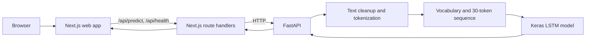

# NextWord AI

**NextWord AI** is an interactive next-word prediction demo powered by a custom LSTM language model. Type a sentence, pause to see ranked suggestions, and select a suggestion to extend the text and explore the next prediction.

| Application | Link |
| --- | --- |
| Web app | [n3xt-word-lstm-ai.vercel.app](https://n3xt-word-lstm-ai.vercel.app/) |
| Prediction API | [n3xtword-lstmai.onrender.com](https://n3xtword-lstmai.onrender.com/) |
| API health | [n3xtword-lstmai.onrender.com/health](https://n3xtword-lstmai.onrender.com/health) |
| Source | [GitHub repository](https://github.com/amandx36/N3xtWord-LstmAi) |

> **Project status:** This is an experimental portfolio/learning project, not a production writing assistant. Model scores are not calibrated guarantees of correctness. No model evaluation metrics are published by this repository.

## What it does

- Predicts automatically after typing pauses, with a manual prediction button as well.
- Offers 3, 5, 7, or 10 candidate words.
- Lets users select a suggestion to append it to their input.
- Shows backend connectivity status in the interface.
- Uses a Next.js server route as a same-origin proxy to the FastAPI service.
- Includes a Jupyter notebook documenting the model development workflow.

## How it works



The API loads the model and vocabulary at startup. Input is normalized using the WikiText cleanup rules, lowercased and tokenized, mapped to vocabulary IDs (`<UNK>` for unknown words), truncated to the most recent 30 tokens, and left-padded with `<PAD>`. Suggestions omit `<PAD>` and `<UNK>`.

## Technology

- **Frontend:** Next.js 16, React 19, TypeScript, Tailwind CSS 4
- **API:** Python 3.12, FastAPI, Pydantic, Uvicorn
- **Inference:** TensorFlow/Keras and NumPy
- **Artifact hosting:** Hugging Face Hub (`amandx360/lstmN3xwordPredictor`)
- **Training exploration:** `NextWordPredictor.ipynb` and WikiText-103

## Repository map

| Path | Description |
| --- | --- |
| `frontendlstm/app/` | Next.js app, UI components, and proxy route handlers |
| `frontendlstm/app/api/` | `/api/predict` and `/api/health` handlers |
| `backend/app/` | FastAPI endpoints, request validation, and inference code |
| `backend/app/artifacts/` | Runtime model and vocabulary location |
| `backend/downloadModelAndVoc.py` | Downloads the model and vocabulary from Hugging Face |
| `NextWordPredictor.ipynb` | Model development/training notebook |
| `docker-compose.yml` | Local two-service container configuration |
| `PRD.md` | Product requirements, including planned (not necessarily implemented) work |

## Run locally

### Prerequisites

- Python 3.12
- Node.js 22 or later and npm
- Network access to download the model artifacts from Hugging Face

### 1. Install backend dependencies and fetch model artifacts

From the repository root, create and activate a virtual environment, then install the backend requirements:

```sh
python3.12 -m venv .venv
source .venv/bin/activate
python -m pip install --upgrade pip
python -m pip install -r backend/requirement.txt
```

Download the model and vocabulary into the location used by the local API:

```sh
cd backend
ARTIFACTS_DIR="$PWD/app/artifacts" python downloadModelAndVoc.py
cd ..
```

The model file is excluded from Git, so a fresh clone needs this download (or a compatible model copied into `backend/app/artifacts/`). The vocabulary JSON is also obtained by the download script; keep it paired with the model that produced it.

### 2. Start the API

From the repository root, with the virtual environment active:

```sh
python -m uvicorn app.main:app --app-dir backend --reload --host 127.0.0.1 --port 8000
```

The API root is [http://127.0.0.1:8000](http://127.0.0.1:8000), interactive docs are at [http://127.0.0.1:8000/docs](http://127.0.0.1:8000/docs), and health is at [http://127.0.0.1:8000/health](http://127.0.0.1:8000/health).

### 3. Start the frontend

In a second terminal:

```sh
cd frontendlstm
npm ci
npm run dev
```

By default, the Next.js server proxies API requests to `http://127.0.0.1:8000`. Override it by creating `frontendlstm/.env.local`:

```dotenv
N3xtharBackendUrl=http://127.0.0.1:8000
```

Open [http://localhost:3000](http://localhost:3000).

## Run with Docker Compose

Docker Compose reads environment files from `frontendlstm/.env` and `backend/app/.env`. From the repository root, copy the provided example file to both locations:

```sh
cp env-example.txt frontendlstm/.env
cp env-example.txt backend/app/.env
```

Build the images and start both services:

```sh
docker compose up --build
```

Open [http://localhost:3000](http://localhost:3000) for the web app, [http://localhost:8000/docs](http://localhost:8000/docs) for the API docs, and [http://localhost:8000/health](http://localhost:8000/health) to check backend readiness. The backend image downloads the model and vocabulary from Hugging Face while it builds, so the first build needs internet access and may take a while. The frontend connects to the backend using the Compose service address `http://backend:8000`.

Stop the services with `docker compose down`. On subsequent starts, `docker compose up` is sufficient unless you changed files or want to rebuild the images; use `docker compose up --build` to rebuild.

## Configuration

The local API defaults to paths under `backend/app/artifacts/`. These settings are optional when using those defaults.

| Variable | Default | Purpose |
| --- | --- | --- |
| `MODEL_PATH` | `backend/app/artifacts/lstm_model.keras` (resolved relative to the application module) | Keras model file |
| `VOCAB_PATH` | `backend/app/artifacts/vocabulary.json` (resolved relative to the application module) | Vocabulary JSON file |
| `SEQ_LEN` | `30` | Number of token positions used for inference |
| `PAD_TOKEN` | `<PAD>` | Vocabulary padding token |
| `UNK_TOKEN` | `<UNK>` | Vocabulary unknown-token marker |
| `CORS_ORIGINS` | `http://localhost:3000,http://localhost:8000` | Comma-separated browser origins permitted by FastAPI CORS |
| `N3xtharBackendUrl` | `http://127.0.0.1:8000` | Backend base URL used by Next.js server-side proxy routes |

For deployment, set `N3xtharBackendUrl` in the **frontend server environment** to the backend's reachable base URL. It is intentionally not a `NEXT_PUBLIC_` variable because browser requests go through the Next.js route handlers.

## API reference

The backend exposes `GET /`, `GET /health`, and `POST /predict`. Next.js exposes same-origin proxies at `GET /api/health` and `POST /api/predict`.

### `GET /health`

Returns HTTP 200 with `status: "ok"` when the artifacts load, or `status: "degraded"` when the service is running without a successfully loaded model. A degraded API cannot return predictions.

```json
{
  "status": "ok",
  "model_loaded": true,
  "detail": null
}
```

### `POST /predict`

Request fields: `text` is required and must be 1–5000 characters; `top_k` is optional, defaults to `3`, and must be between `1` and `10`.

```sh
curl -X POST http://127.0.0.1:8000/predict \
  -H 'Content-Type: application/json' \
  -d '{"text":"The future of artificial intelligence","top_k":3}'
```

Response shape (candidate words and scores vary by model/input):

```json
{
  "input": "The future of artificial intelligence",
  "predictions": [
    { "word": "...", "probability": 0.0 }
  ],
  "predicted_word": "...",
  "confidence": 0.0
}
```

When candidates are returned, `predicted_word` and `confidence` mirror the first candidate. The probability is the model's output score, not a calibrated measure of real-world certainty. Invalid request fields are rejected by Pydantic; text that contains no tokenizable words is rejected with HTTP 422, and an unavailable model results in HTTP 503.

## Model notes and limitations

The notebook explores an LSTM model trained on WikiText-103. The serving code expects a saved Keras model and a matching vocabulary JSON containing `word_to_id` and `id_to_word` maps, including `<PAD>` and `<UNK>`. Inference depends on the model and vocabulary being compatible; replacing one without the other may yield errors or meaningless suggestions.

This system predicts a single next token from a fixed-length context. It may return repetitive, dated, nonsensical, or biased text. It is not a conversational language model and should not be used for high-stakes decisions. The repository does not provide verified accuracy, latency, or other evaluation metrics; do not infer model quality from a sample prediction.

## Validation and maintenance

Frontend scripts (run from `frontendlstm/`):

```sh
npm run lint
npm run build
```

The repository does not currently define a dedicated automated backend or integration test suite. Verify API health and a sample prediction manually after changing model artifacts, preprocessing, or dependencies.

## Container status

The Compose setup is intended for local development. The frontend container runs `next dev`, not a production server; use a production-ready frontend image and deployment configuration before using containers in production.

## Security and privacy considerations

The public API is a demo endpoint. Before exposing a deployment to real users, add appropriate rate limiting and abuse protection, review request logging and retention, keep dependencies and model artifacts maintained, and configure HTTPS and restrictive CORS for the deployed origins. Do not send sensitive or confidential text to the demo. No authentication, persistence, or user account functionality is implemented.

## License

No `LICENSE` file is currently present. Until a license is added, reuse and redistribution permissions are not specified; contact the repository owner before treating the code or model artifacts as open source.
